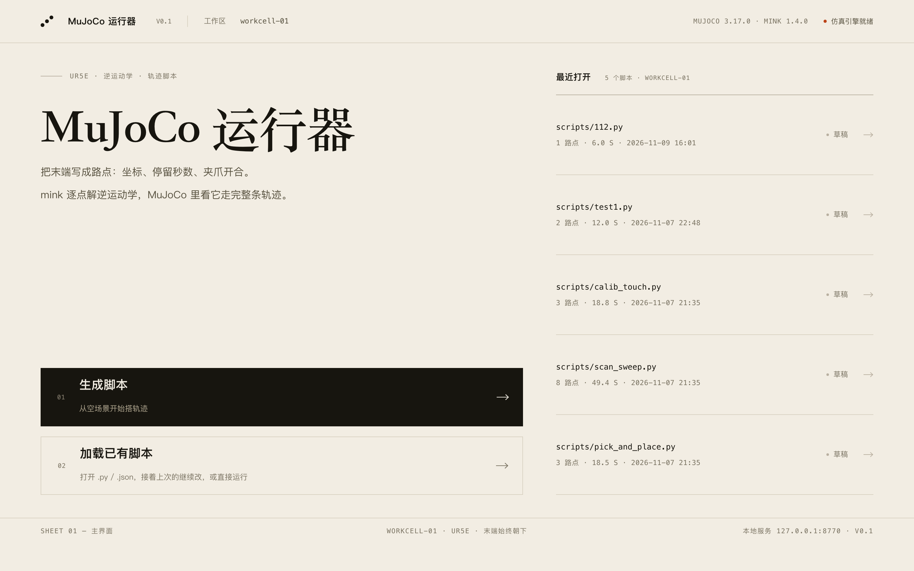
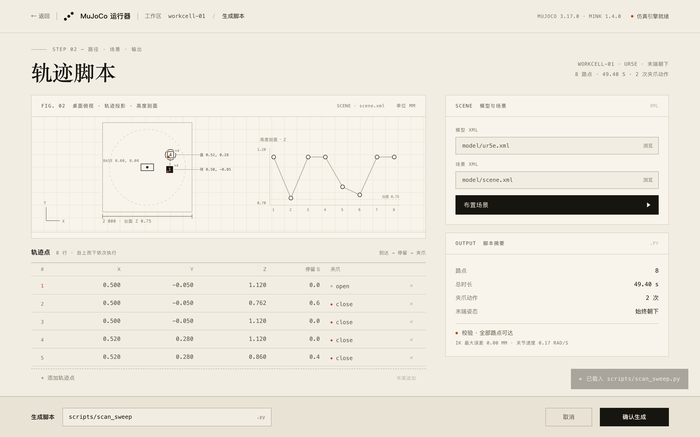

# MuJoCo 脚本生成器 · UR5e

在网页上点几个轨迹点、把球和盘子拖到想要的位置，直接生成能在 MuJoCo 里跑的 UR5e 抓取脚本。





## 它解决什么

写一个 UR5e 抓取脚本，原本要手改代码里的 `WAYPOINTS`、调 IK 参数、重新跑一遍才知道末端到不到得了。
这个工具把这些搬到网页上：俯视图里看到桌面、机械臂底座、球和盘子的**真实坐标**，改完路点当场生成脚本。

## 快速开始

### Windows

1. 安装 [Python 3.10+ 64 位](https://www.python.org/downloads/windows/)，安装时勾选 **Add python.exe to PATH**；
2. 双击 `安装依赖.bat`（自动创建 `.venv` 并装 mujoco / mink / numpy）；
3. 双击 `start.bat`，浏览器自动打开 <http://127.0.0.1:8770/>。

### macOS / Linux

```bash
python3 -m venv .venv
.venv/bin/pip install -r requirements.txt
.venv/bin/python server/app.py
# 浏览器打开 http://127.0.0.1:8770/
```

macOS 上「布置场景」窗口由 `mjpython` 拉起（MuJoCo 的硬性要求），
所以请用 venv 里的解释器启动服务，或安装 `mjpython` 到同一环境。

## 怎么用

**主界面**：「生成脚本」从空场景开始；「加载已有脚本」把上次的路点和场景读回来。

**副界面**：

- 俯视图画的是场景 XML 里解析出来的真实坐标，不是演示数据；
- 轨迹点表格默认 1 行，点「+ 添加轨迹点」即追加，超过 5 行表格内部滚动；
- 「布置场景」弹出 MuJoCo 窗口：双击选中物体、`Ctrl + 右键拖动` 推它，按 `S` 或直接关窗都会保存；
  保存后页面立刻切到新场景，坐标同步更新；
- 「确认生成」写出 `scripts/<名字>.py`，并把当前场景写进脚本的 `XML_PATH`。

生成好的脚本就是普通 Python：

```bash
# 不开窗口，跑完打印精度并存 out/trajectory.csv
.venv/bin/python scripts/脚本名.py
# 开窗口看机械臂动
.venv/bin/python .venv/bin/mjpython scripts/脚本名.py --gui     # macOS
.venv/Scripts/python.exe scripts/脚本名.py --gui                # Windows
```

## 目录

```
.
├── start.bat / 安装依赖.bat      Windows 一键启动 / 装依赖
├── server/                       本地服务（只用 Python 标准库）
│   ├── app.py                    静态站点 + /api/*
│   ├── scene.py                  场景 XML 解析：物品真实坐标、桌面、底座
│   ├── layout.py                 路点 → 脚本的参数替换 + 反解析已有脚本
│   └── layout_editor.py          MuJoCo 布置窗口（拖动 + 保存场景）
├── web/                          网页界面（原生 HTML/CSS/JS + GSAP）
├── scripts/                      生成的脚本（自带示例 test1.py）
├── out/                          轨迹 CSV、布置记录、日志
├── model/                        UR5e 模型与场景（scene.xml、ur5e.xml、assets/、scenes/）
└── action/arm_motion.py          生成脚本用的模板
```

## 实现要点

- **零第三方依赖的服务端**：`http.server.ThreadingHTTPServer` 起 API，静态根就是 `web/`；
- **IK 用 [mink](https://github.com/kevinzakka/mink)**：模板脚本里沿直线迭代求解，末端保持工具轴朝下；
- **布置场景**：`mujoco.viewer.launch_passive` 起被动窗口，保存时只改自由物体的 `pos`，
  并把 `<include>` / `meshdir` 重定位到 `model/scenes/`，产出可独立加载的 `scene_layout_*.xml`；
- **路径自适应**：所有模块从自身位置向上查找含 `model/ur5e.xml` 的目录当项目根，
  同一份代码放进扁平分发包也能跑；
- **脚本 ROOT 同理**：生成的脚本不写死层级，挪到任何位置都能找到模型。

## 已知限制

- 服务只监听 `127.0.0.1`，不对外提供访问；
- 同一时间只支持一个「布置场景」窗口；
- 俯视图是几何粗判（工作半径 0.85 m），路点能不能到最终由生成脚本时的 IK 决定。

## License

MIT
